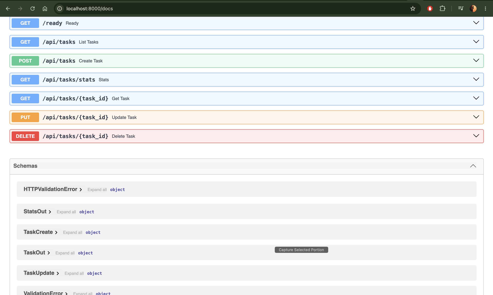
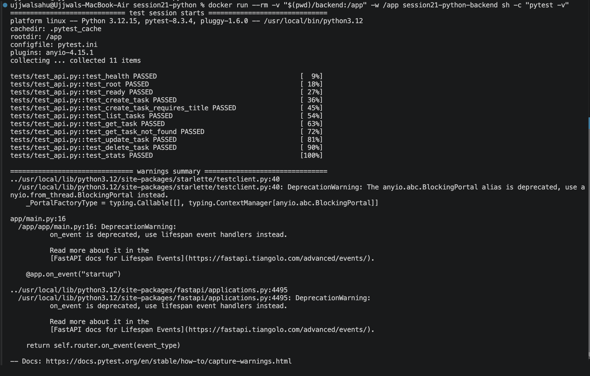
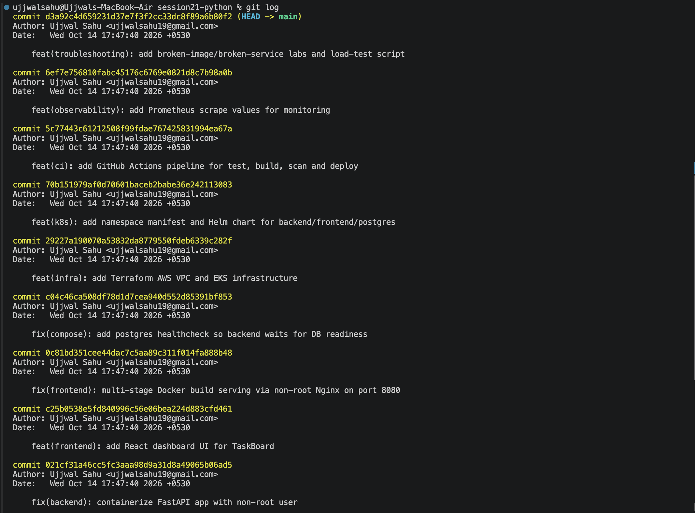
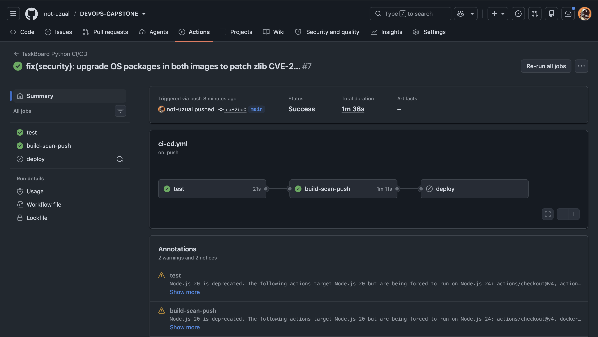

### Trivy scanned our backend and frontend container images for OS-package and Python-dependency vulnerabilities with severity HIGH or CRITICAL. It caught CVE-2026-22184, a buffer-overflow vulnerability in zlib shipped by the nginx:1.27-alpine base image, and failed the pipeline before the image could be pushed to GHCR. We fixed it by adding an apk upgrade step to the frontend Dockerfile to pull the patched zlib package, verified the new version was installed, then re-ran the pipeline to confirm it passed.

