# SUBMISSION EVIDENCE

## [Video Link](https://drive.google.com/file/d/1ogy-uzPNM91NdBoJ8Jyt2yhjSH70W-W_/view?usp=sharing)

Screenshots captured while building and grading this capstone, organized by GRADING.md module.

## M1 — Application

Frontend dashboard running at `localhost:3000`:

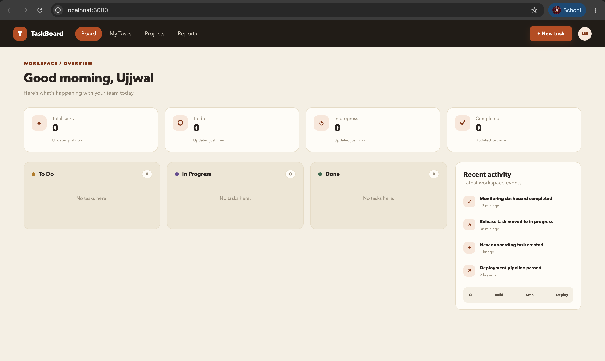

FastAPI Swagger docs at `/docs` showing all REST endpoints:

## M2 — Testing

`pytest -v` — 11 tests passing, covering health/readiness and full task CRUD:

## M3 — Git and GitHub

Commit history after rebuilding it into feature/fix-scoped commits:

## M4 — Docker

`docker compose up --build` bringing up postgres, backend (Alembic migration + Uvicorn), and frontend (Nginx) successfully:

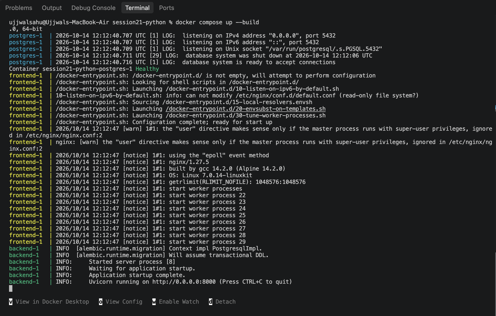

## M5 — CI/CD

GitHub Actions pipeline green across `test` and `build-scan-push`:

## M6 — DevSecOps (Trivy)

Trivy scan of the frontend image — clean, 0 vulnerabilities after patching zlib (CVE-2026-22184):

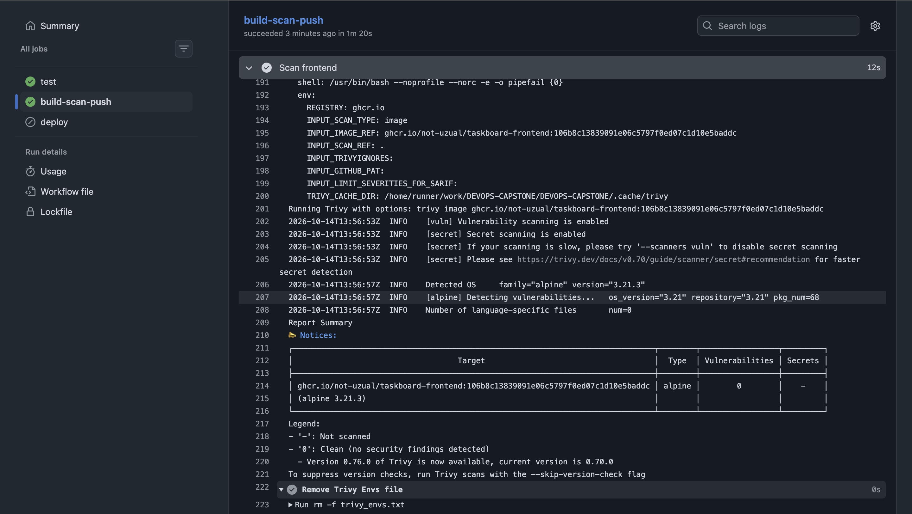

Trivy scanning both backend and frontend images in the pipeline:

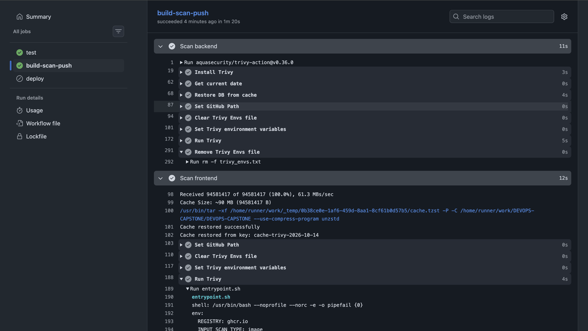

> Trivy scanned our backend and frontend container images for OS-package and Python-dependency vulnerabilities with severity HIGH or CRITICAL. It caught CVE-2026-22184, a buffer-overflow vulnerability in zlib shipped by the `nginx:1.27-alpine` base image, and failed the pipeline before the image could be pushed to GHCR. We fixed it by adding an `apk upgrade` step to the frontend Dockerfile to pull the patched zlib package, verified the new version was installed, then re-ran the pipeline to confirm it passed. It also caught CVE-2026-54283 in Starlette (pulled in transitively via FastAPI), which we fixed by upgrading FastAPI and pinning a patched Starlette version directly.

## M7 — Terraform (AWS VPC + EKS)

`terraform plan` — 54 resources to add, 0 to change, 0 to destroy:

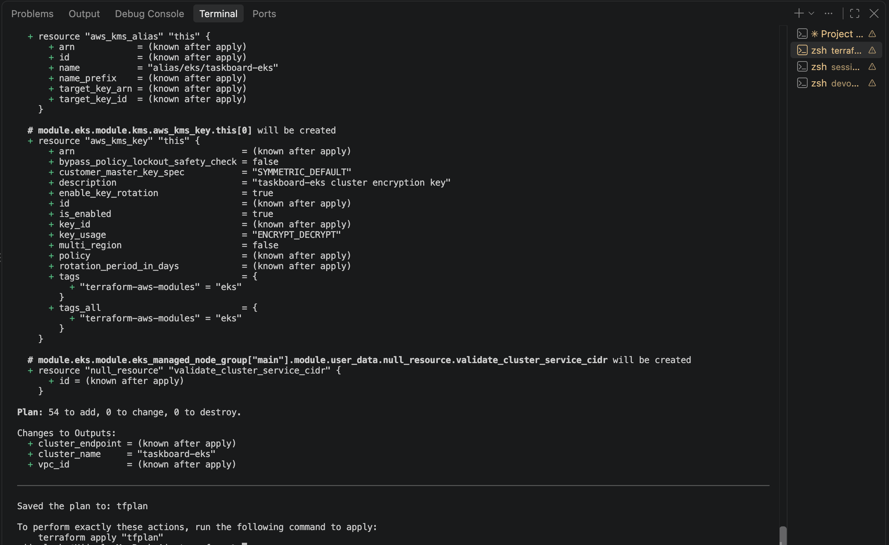

`kubectl get nodes` against the live EKS cluster — both worker nodes Ready:

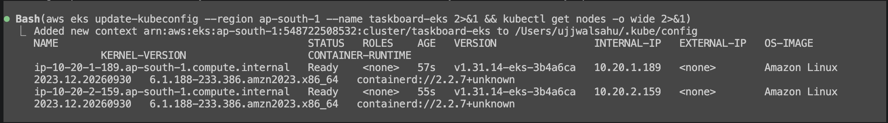

AWS Console — EKS cluster `taskboard-eks` Active in `ap-south-1`:

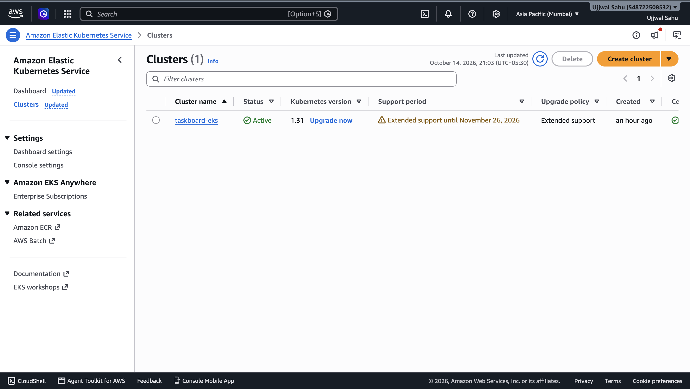

AWS Console — VPC `taskboard-vpc` with public/private subnets:

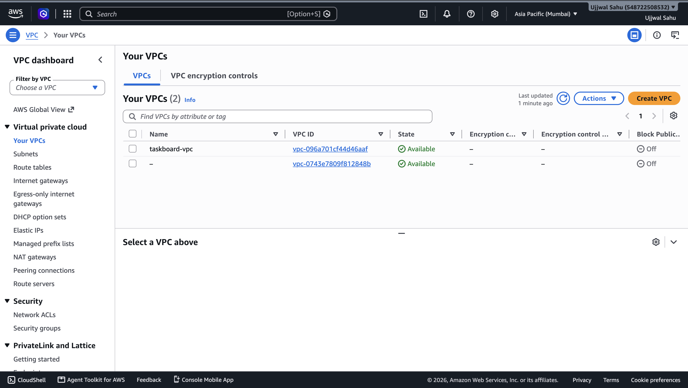

`terraform destroy` — all 54 resources torn down cleanly to avoid ongoing AWS charges:

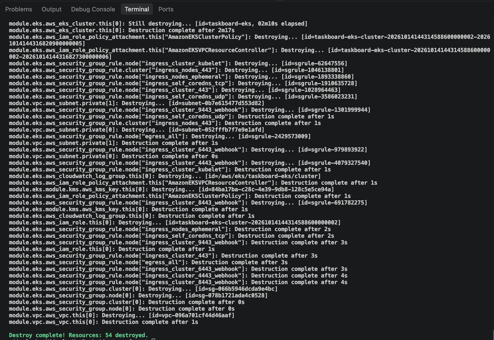

## M8 — Kubernetes + Helm

`kubectl get pods`/`get svc`, `helm list`, and `minikube tunnel` for local Ingress access:

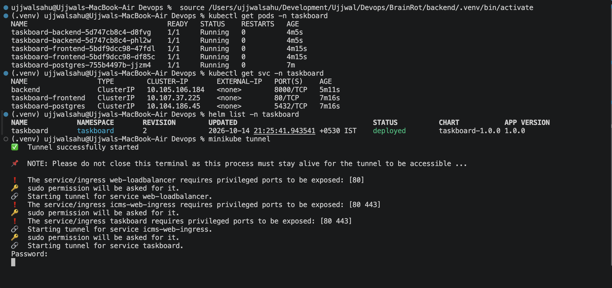

Ingress routing troubleshooting while wiring up `taskboard.local`:

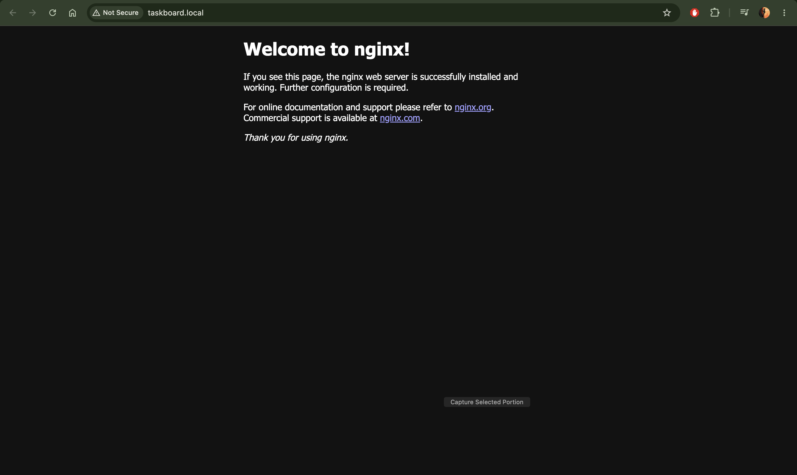
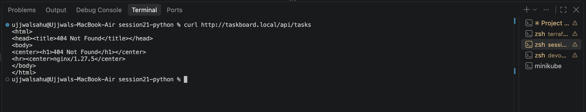

## M9 — Observability (Prometheus + Grafana)

`curl http://localhost:8000/metrics` — Prometheus-formatted output from the backend:

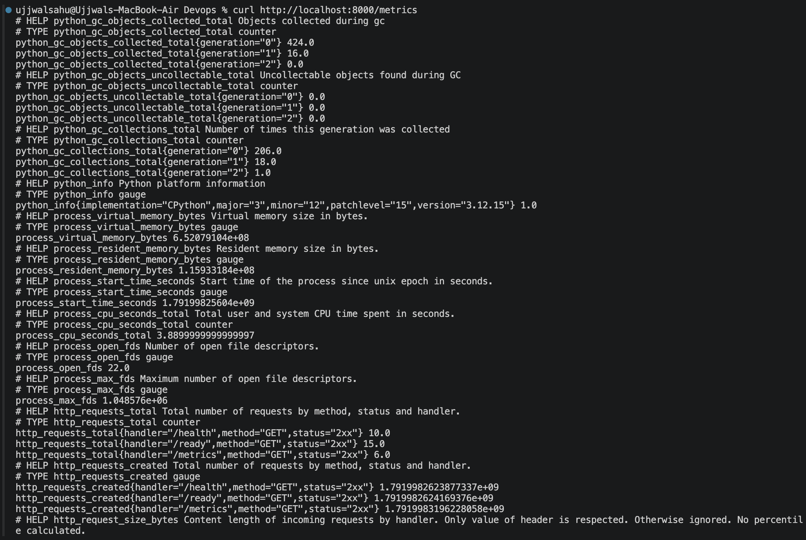
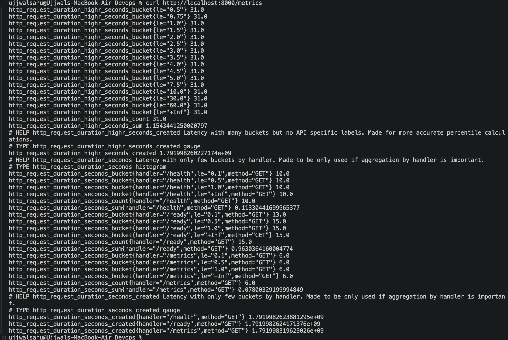

Prometheus Targets page — backend ServiceMonitor target `UP` (6/6 pods scraped):

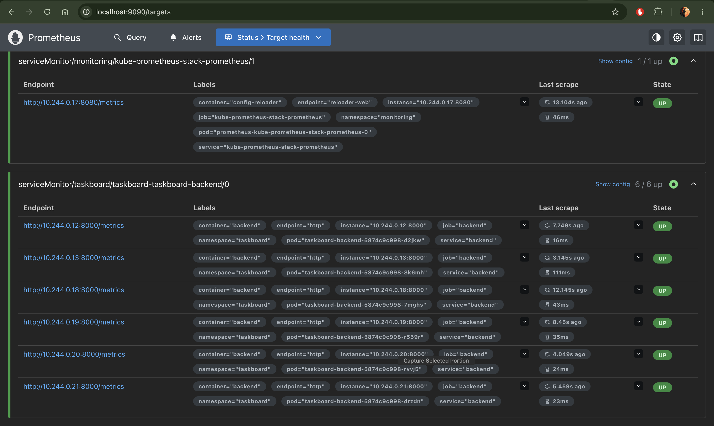

Grafana panel showing live `rate(http_requests_total[5m])` from the backend:

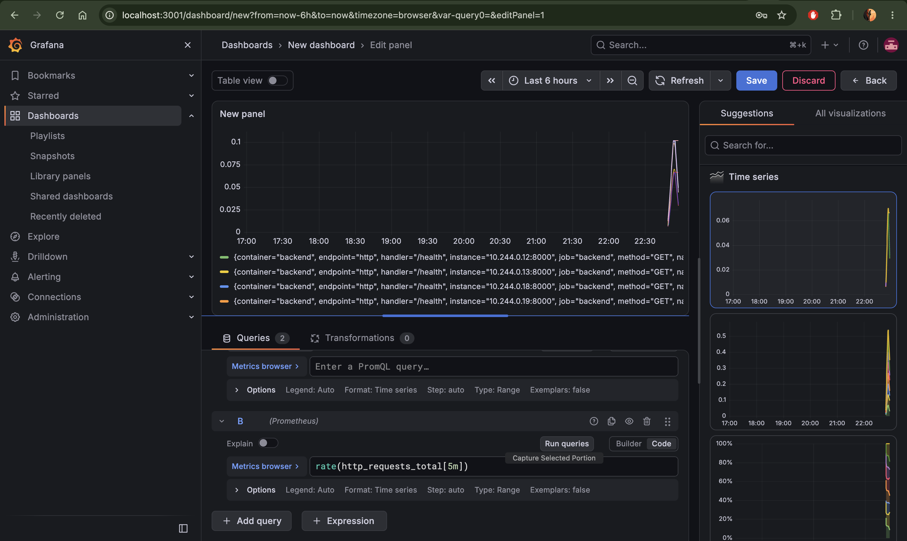
